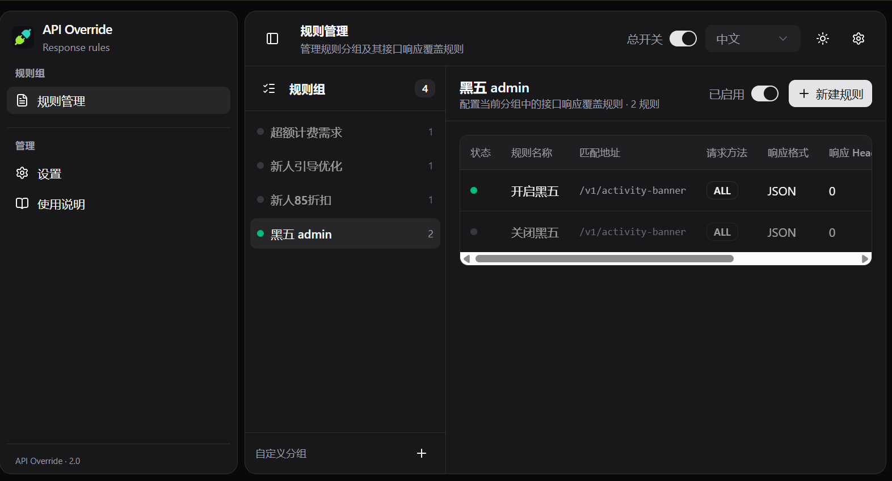

<div align="center">


# API Override

**Ajax/Fetch response interceptor & mocking tool, as a browser extension**

English · [简体中文](./README.md)


</div>



## ✨ Features

- 🗂️ **Rule groups** — include / `*` wildcard / regex matching with optional method filter, drag to reorder
- 🎯 **Response overrides** — JSON full / incremental, Text / JavaScript / HTML / CSS / file responses, headers & status codes
- 📤 **Request override** — replace the request body of non-GET requests per rule
- 🧪 **Mock.js** — `@cname`, `@integer(1, 100)` out of the box; the bundled Mock is exposed as `window.Mock`
- 📦 **Import / export** — group JSON import & export, quick import from the panel header
- 🌗 **Themes** — light / dark, Chinese & English

## 🚀 Quick start

```bash
pnpm install
pnpm build
```

1. In `chrome://extensions`, enable "Developer mode" → "Load unpacked" → select `apps/extension/dist`
2. Create a rule, fill in the match pattern (e.g. `/v1/activity-banner`), pick a response type and save
3. Turn on the global switch and refresh the target page

## 📄 License

[MIT](./LICENSE)
