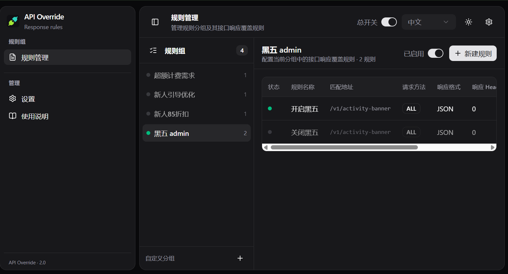

<div align="center">


# API Override

**浏览器扩展版的 Ajax/Fetch 响应拦截与 Mock 工具**

[English](./README.en.md) · 简体中文


</div>



## ✨ 特性

- 🗂️ **规则分组** — 包含 / `*` 通配符 / 正则匹配，可限定请求方法，支持拖拽排序
- 🎯 **响应覆盖** — JSON 全量 / 增量、Text / JavaScript / HTML / CSS / 文件响应，响应头与状态码
- 📤 **请求覆盖** — 非 GET 请求可按规则替换请求体
- 🧪 **Mock.js** — `@cname`、`@integer(1, 100)` 开箱即用，内置 Mock 挂载为 `window.Mock`
- 📦 **导入导出** — 分组 JSON 导入导出，面板顶栏支持快速导入
- 🌗 **明暗主题** — 中英双语

## 🚀 快速开始

```bash
pnpm install
pnpm build
```

1. `chrome://extensions` 开启「开发者模式」→「加载已解压的扩展程序」→ 选择 `apps/extension/dist`
2. 新建规则，填匹配地址（如 `/v1/activity-banner`），选响应格式并保存
3. 打开「总开关」，刷新目标页面即可生效

## 📄 License

[MIT](./LICENSE)
