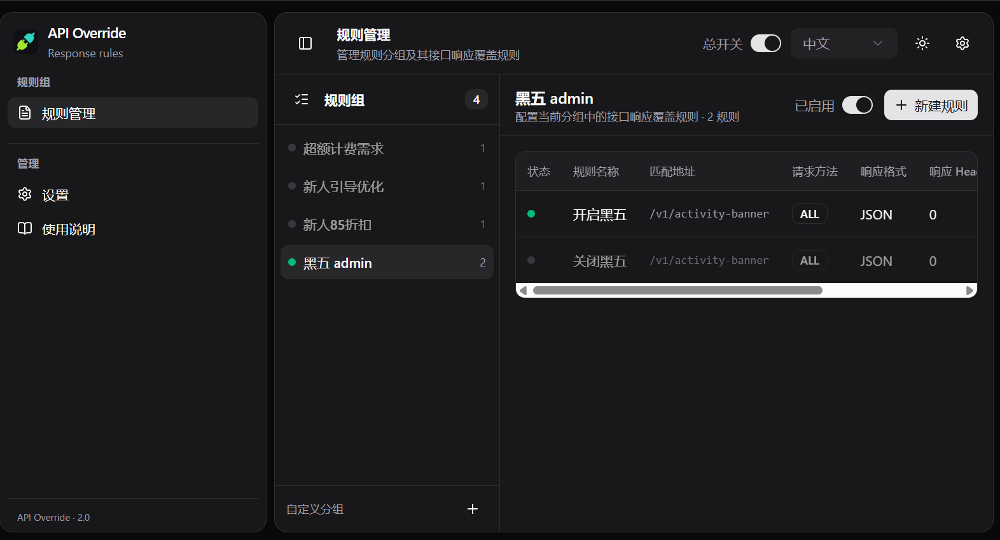

<div align="center">


# API Override

**浏览器扩展版的 Ajax/Fetch 响应拦截与 Mock 工具**

拦截任意页面的 XHR / Fetch 请求，用规则分组管理响应覆盖，完整兼容 Mock.js 语法。

[English](./README.en.md) · 简体中文


</div>



## ✨ 特性

- 🗂️ **规则分组** — 规则按分组管理，支持包含 / `*` 通配符 / 正则匹配，可限定请求方法
- 🎯 **响应覆盖** — JSON 全量覆盖或增量合并、纯文本、文件响应、响应头与状态码覆盖
- 🧪 **Mock.js 语法** — `@cname`、`@integer(1, 100)`、`"list|1-3"` 开箱即用，裸占位符免引号
- 🧠 **专家模式** — 用 JS 函数动态生成请求头、请求体与响应
- 📦 **导入导出** — 规则组 JSON 导入（按名称合并）、导出与空白模板下载
- 🌗 **明暗主题** — 中英双语，亮色 / 暗色主题切换

## 🚀 快速开始

```bash
pnpm install
pnpm build
```

1. 打开 `chrome://extensions`，开启「开发者模式」
2. 「加载已解压的扩展程序」→ 选择 `apps/extension/dist`
3. 点击工具栏图标，新建规则即可生效

### 基本用法

1. 新建分组（或使用默认分组），点击「新建规则」
2. 填写匹配地址，如 `/v1/activity-banner`（支持 `*` 通配符与正则）
3. 选择响应格式（JSON / 文本 / 文件），填入响应内容，保存并开启规则
4. 打开右上角「总开关」，刷新目标页面即可生效

## 🧪 Mock.js 支持

响应内容完整兼容 [Mock.js](https://github.com/nuysoft/Mock) 语法

```json
{
  "code": 0,
  "name": "@cname",
  "list|1-3": [{ "id|+1": 1, "email": "@email" }]
}
```

## 📄 License

[MIT](./LICENSE)
